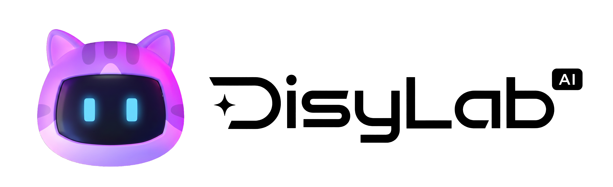

<p align="center">
  <picture>
    <source media="(prefers-color-scheme: dark)" srcset="docs/assets/logo-black.png" />
    <source media="(prefers-color-scheme: light)" srcset="docs/assets/logo-white.png" />
    
  </picture>
</p>

<h1 align="center">DisyLab Canvas</h1>

<p align="center">
  <a href="README.md">简体中文</a> · <a href="README.zh-TW.md">繁體中文</a> · English
</p>

<p align="center">
  <strong>Keep characters, references, prompts, and every creative attempt on one canvas that grows with your work.</strong>
</p>

<p align="center">
  A local-first AI infinite canvas for designers, commerce creatives, and content creators.
</p>

<p align="center">
  <a href="https://disylab.pages.dev">Live App</a> ·
  <a href="https://tyaash.github.io/DisyLab-Canvas/">Project Site</a> ·
  <a href="#quick-start">Quick Start</a> ·
  <a href="https://github.com/TyaAsh/DisyLab-Canvas/releases/download/v2.0.2/DisyLab_2.0.2_x64.exe">Download for Windows</a> ·
  <a href="https://tyaash.github.io/DisyLab-Canvas/#roadmap">Roadmap</a>
</p>

<p align="center">
  
  
  
  
</p>

> [!IMPORTANT]
> **DisyLab is proprietary source-available software, not open-source software.** Commercial use, sale, rental, white-labeling, redistribution, relicensing, and paid services based on this project or modified versions require prior written permission from the copyright holder. See [LICENSE](LICENSE) and [COMMERCIAL-LICENSE.md](COMMERCIAL-LICENSE.md).

## Current highlights

- **Skill system:** use guided Skills one question at a time in chat, apply compatible Skills directly to text, image, or video nodes, and manage imported Skills.
- **Comic storyboard workflow:** move from content breakdown and layout selection to composition approval and asset generation in one editable node flow.
- **File toolbox:** compress images, videos, and PDFs, merge PDFs, or select regions for image and video watermark removal.
- **Personal workspace and projects:** a unified project home with search, grid/list views, batch selection, and import/export.
- **Interaction and stability fixes:** corrected overlay stacking, hidden dialogs, minimap dragging, and Skill panel readability.
- **Context-aware Disy Agent:** uses the originating project, canvas, selected nodes, references, and conversation history to decide between planning and execution.
- **Background canvas runs:** Agent and media tasks remain attached to their source canvas while users browse other projects.
- **Project Agent tools:** manage project memory, follow tasks, and configure team roles for the type of work.
- **Generation confirmation:** choose an available model and supported settings before generation, including image count.
- **Canvas layers:** dock or float the layer panel and group, duplicate, rename, or reorder layers.
- **Recoverable video media:** generated videos are archived locally when possible, with controlled relay recovery for frame capture, trimming, and cropping.

## Core capabilities

- Infinite canvas, node connections, and multi-canvas projects.
- Text, upload, image, video, and Agent workflows.
- Image generation, video generation, trimming, cropping, and frame capture.
- Workflow templates, inspiration library, asset library, and generation history.
- Local-first storage with `.disy` project import and export.
- Configure the API connection you need directly in the app.
- API keys are stored separately and are not embedded in exported project packages.

## Quick start

Node.js 22.12 or newer is required.

```bash
npm ci
npm run dev
```

Production checks:

```bash
npm run typecheck
npm test
npm run build
```

## Current scope

DisyLab 2.0 is available on the web and for Windows x64. The desktop app supports official Jimeng CLI authorization and a separate Muse web sign-in session. macOS is planned for a later release. Projects remain local and can be transferred using `.disy` packages. See the [2.0.2 release](https://github.com/TyaAsh/DisyLab-Canvas/releases/tag/v2.0.2) for downloads and the checksum.

## License

Copyright © 2026 Ash / Tya. All rights reserved. See [LICENSE](LICENSE), [LICENSE.zh-CN.md](LICENSE.zh-CN.md), and [COMMERCIAL-LICENSE.md](COMMERCIAL-LICENSE.md).
