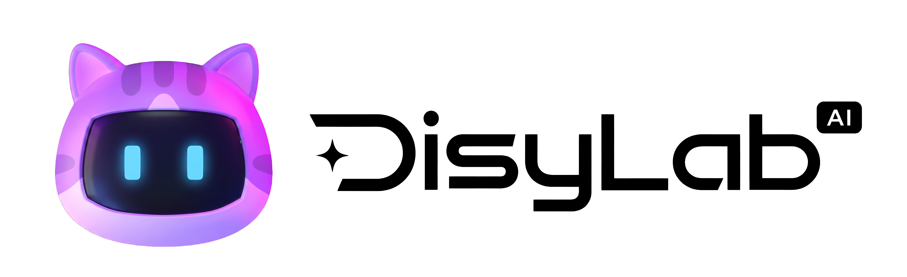
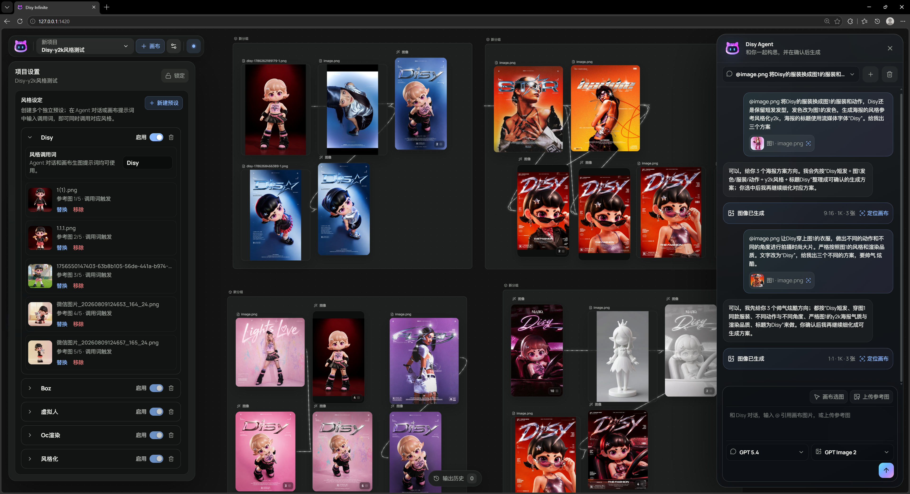
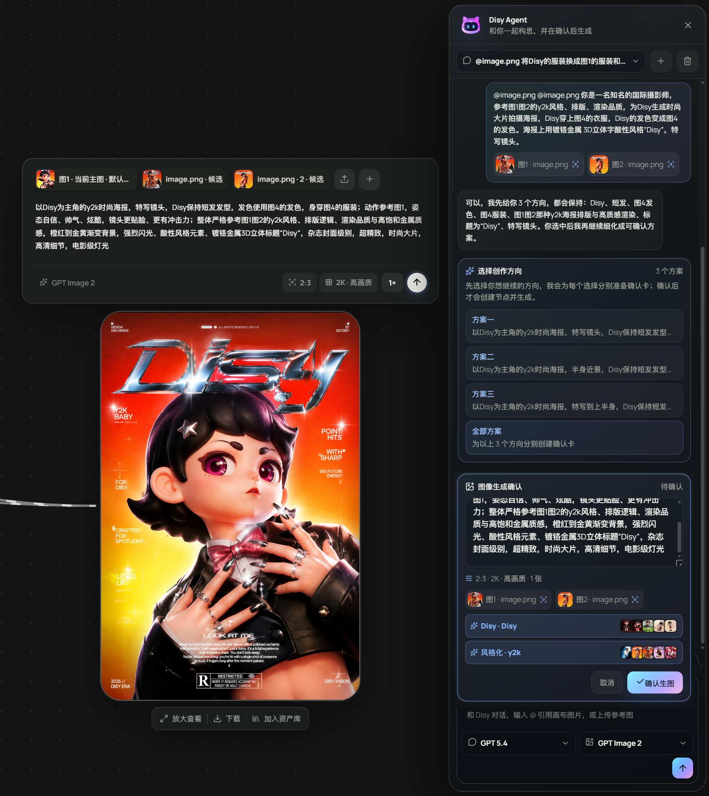
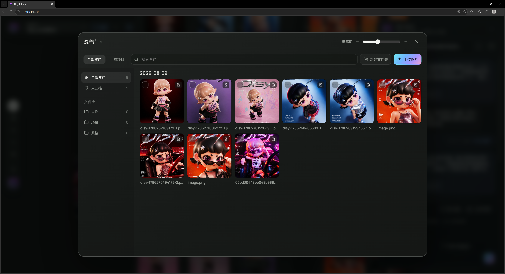

<p align="center">
  <picture>
    <source media="(prefers-color-scheme: dark)" srcset="docs/assets/logo-black.png" />
    <source media="(prefers-color-scheme: light)" srcset="docs/assets/logo-white.png" />
    
  </picture>
</p>

<h1 align="center">DisyLab Canvas</h1>

<p align="center">
  <a href="README.md">简体中文</a> · <a href="README.zh-TW.md">繁體中文</a> · English
</p>

<p align="center">
  <strong>Keep characters, references, prompts, and every creative attempt on one canvas that grows with your work.</strong>
</p>

<p align="center">
  A local-first AI infinite canvas for designers, commerce creatives, and content creators.
</p>

<p align="center">
  <a href="https://disylab.pages.dev">Live App</a> ·
  <a href="https://tyaash.github.io/DisyLab-Canvas/">Project Site</a> ·
  <a href="#quick-start">Quick Start</a> ·
  <a href="https://tyaash.github.io/DisyLab-Canvas/#roadmap">Roadmap</a>
</p>

<p align="center">
  
</p>

> [!IMPORTANT]
> **DisyLab is proprietary source-available software, not open-source software.** Commercial use, sale, rental, white-labeling, redistribution, relicensing, and paid services based on this project or modified versions require prior written permission from the copyright holder. See [LICENSE](LICENSE) and [COMMERCIAL-LICENSE.md](COMMERCIAL-LICENSE.md).

## Start creating in four steps

1. Open the [web app](https://disylab.pages.dev/) and create a project.
2. In **Settings → API settings**, add your provider URL and API key, fetch models, and enable the text, image, or video models you want. Your selected provider charges for generation.
3. Open Disy Agent and describe what you want. Add reference images or videos if you have them; you can also explore ideas first.
4. Review the result, ask for changes, and download your assets. Export a **.disy** project package for backup.

Projects are stored in your current browser, rather than synchronized to a cloud account. Export before clearing browser data or changing devices. API keys are excluded from project exports.



## Recent improvements

- **Instant language switching:** choose Simplified Chinese, Traditional Chinese, or English under Settings → Language & display. No reload or navigation is needed.
- **Natural Agent conversations:** Smart mode decides when to suggest directions or proceed; Collaborate reviews a proposal first; Generate directly reduces unnecessary confirmation. Missing or conflicting requirements still receive an explanation.
- **Your model, your settings:** choose image/video models and supported parameters in the composer. Agent video offers reference generation, video editing, and start/end frames, subject to the model's capabilities.
- **Updated image controls:** Seedream 5.5 includes 21:9 and 9:21. Transparent-background and GIF switches appear only for supported connections and models. Canvas nodes and Agent share the same capability rules.
- **Editable messages:** hover over your sent message to copy or edit it in place. The main composer remains available, and messages include timestamps.
- **Clearer results and errors:** browse multiple images or video versions. Output history shows successful and failed requests, with the actual error when available.
- **Reference framing:** center references without stretching. Requests to preserve complete content use content-preserving framing; the generation model may still alter details.
- **Consistent dialogs:** unified size and appearance, clearer English category spacing, and no duplicate Auto option.
- Project memory, the old team-role interface, and MUSE integration have been removed.

## Work with Disy Agent

Start with a purpose and mood, or provide exact dimensions, quantity, model, and references. Agent uses the canvas context, offers directions when needed, and can keep an editable confirmation card for review. You can explicitly ask for a proposal without generation. Prompt optimization can be undone.



## Organize your work

Keep text, images, videos, references, and results on connected canvas nodes. Reorder references, choose a main result from multiple versions, and reuse materials through the asset library. Image tools include regional editing, outpainting, background removal, and grid splitting; video tools include frame capture and cropping. The inspiration library, reusable Skills, and local file toolbox support repeatable workflows.



## Quick start

Install Node.js **22.12 or later**, then run:

```bash
git clone https://github.com/TyaAsh/DisyLab-Canvas.git
cd DisyLab-Canvas
npm ci
npm run dev
```

Open **http://127.0.0.1:1420/**. On Windows, after installing dependencies once, double-click **启动 DisyLab.vbs** in the project folder. It starts the local web app if necessary and opens your browser; repeated launches reuse the running service. After restarting Windows, double-click it again. Startup logs live in **.local/run/** and are excluded from the repository.

This repository publishes the web application and local web launcher, without the desktop installer project.

## Data and privacy

Projects, assets, history, and conversations are stored locally in the browser. Back up with .disy exports. API keys stay in the current tab session and are excluded from project exports. Generation sends prompts and selected references to your configured provider. HFSY video references may be uploaded temporarily so the provider can access them, normally expiring after four hours. Never include API keys in public screenshots or issues.

## Checks and deployment

```bash
npm test
npm run build
npx wrangler pages deploy dist --project-name disylab --branch main
```

Deployment requires your own Cloudflare login and Pages project. The [project introduction](https://tyaash.github.io/DisyLab-Canvas/) is published separately from the [live application](https://disylab.pages.dev/).

## Feedback and license

[Report an issue](https://github.com/TyaAsh/DisyLab-Canvas/issues) with reproduction steps, expected and actual behavior, browser, and model name. Do not include your API key. Contact: ashhaveaniceday@gmail.com.

Copyright © 2026 DisyLab. All rights reserved. This is proprietary source-available software; public visibility and forks do not grant commercial or redistribution rights. See [LICENSE](LICENSE), [Chinese license](LICENSE.zh-CN.md), [NOTICE](NOTICE.md), and [commercial licensing](COMMERCIAL-LICENSE.md).
