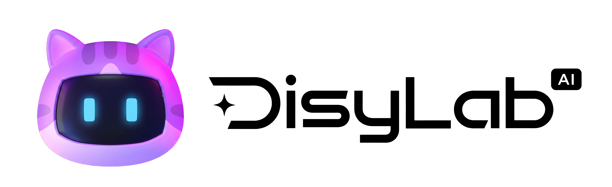
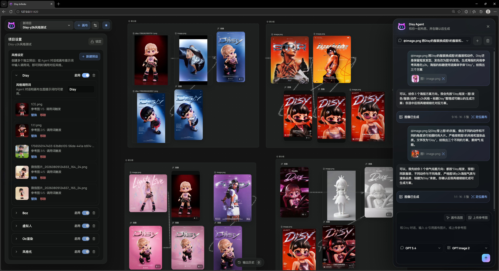
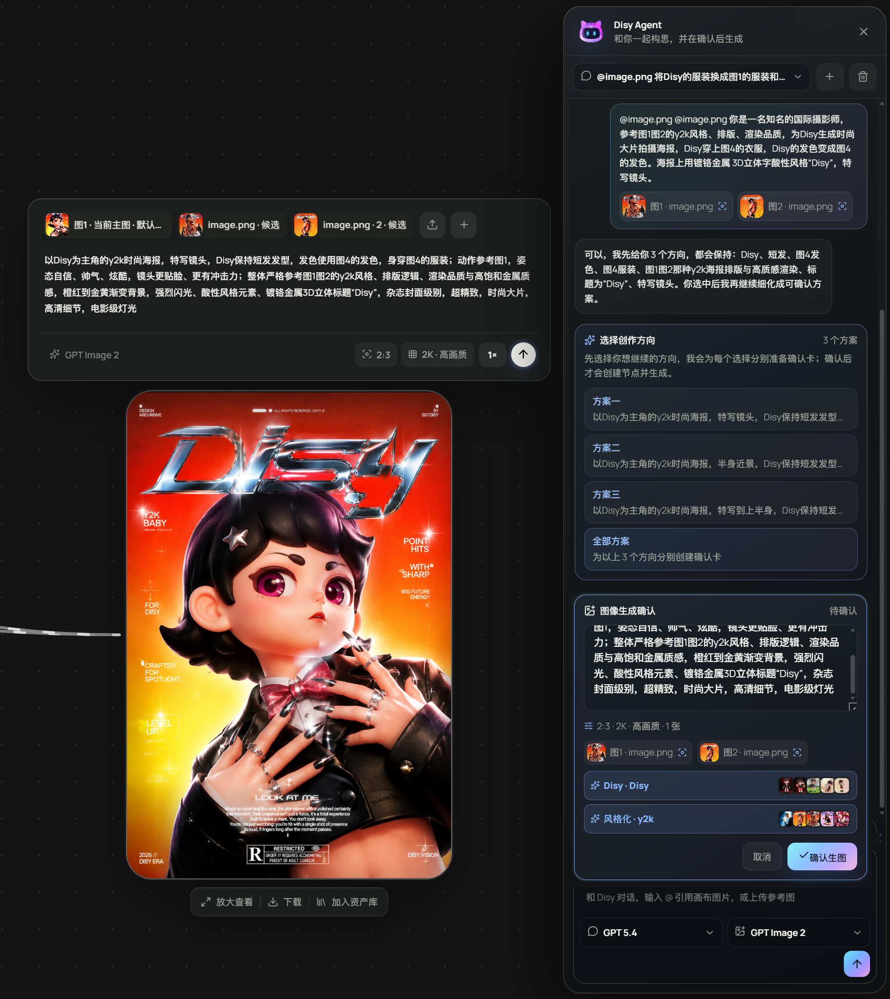
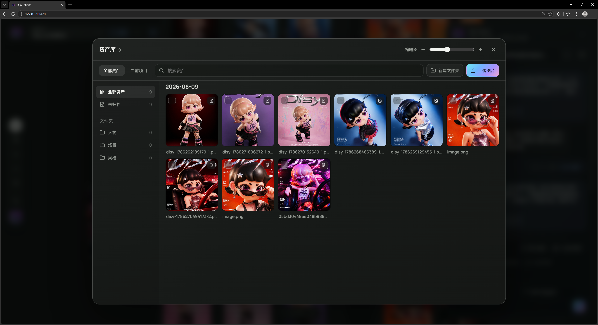

<p align="center">
  <picture>
    <source media="(prefers-color-scheme: dark)" srcset="docs/assets/logo-black.png" />
    <source media="(prefers-color-scheme: light)" srcset="docs/assets/logo-white.png" />
    
  </picture>
</p>

<h1 align="center">DisyLab Canvas</h1>

<p align="center"><strong>把灵感、参考素材、生成过程和可复用资产留在同一张会生长的画布上。</strong></p>
<p align="center">面向设计师、电商视觉工作者与内容创作者的本地优先 AI 无限画布。</p>

<p align="center">
  <a href="https://disylab.pages.dev/">在线体验</a> ·
  <a href="https://tyaash.github.io/DisyLab-Canvas/">项目介绍</a> ·
  <a href="#本地运行">本地运行</a> ·
  <a href="#部署">部署</a> ·
  <a href="README.en.md">English</a> ·
  <a href="README.zh-TW.md">繁體中文</a>
</p>

<p align="center">
  
</p>

> [!IMPORTANT]
> DisyLab 是源码公开可见（source-available）的专有软件，不是开源软件。未经书面许可，不得商用、售卖、白标、再分发或将本项目及其修改版本用于收费服务。详见[中文授权声明](LICENSE.zh-CN.md)与[英文许可证](LICENSE)。

## 这是什么？

DisyLab Canvas 是一张用来做设计和视频的 AI 无限画布。你可以把想法、参考图、视频、提示词和生成结果放在一起，边聊边做，不用在多个工具之间来回搬素材。



## 第一次使用，跟着这四步走

1. 打开[在线版](https://disylab.pages.dev/)，新建一个项目。
2. 在「设置 → API 设置」中填写自己的厂商地址和 API Key，获取模型后，勾选要用的文字、图像或视频模型。生成费用由你选择的厂商收取。
3. 打开 Disy Agent，说出想做什么；有参考图或视频就一起添加。没有完整想法也可以先聊方向。
4. 查看结果，不满意可以继续描述修改。完成后下载素材，或导出 `.disy` 项目包，留作备份。

例如：“帮我做一张暖色咖啡海报，竖版 9:16，不要文字。”

**重要：**在线版的数据保存在当前浏览器，不是云端同步。清理浏览器数据或换设备前，请先导出项目。API Key 不会随项目包导出。

## 最近更新

- **三种界面语言**：在「设置 → 语言与显示」中切换简体中文、繁體中文或 English，立即生效，不需要刷新页面。
- **更自然的 Agent 对话**：智能模式会根据需求清晰程度给建议或推进制作；协作模式先讨论方案；直接生成模式减少不必要的确认。重要信息缺失或需求有冲突时，仍会先说明。
- **图片和视频自己选模型**：模型、比例、清晰度、时长等参数在输入区就能调整，可选范围跟随当前模型。视频提供参考图/视频、视频编辑、首尾帧三种工作方式，支持情况由模型决定。
- **图像规格补齐**：补入 Seedream 5.5 的 21:9、9:21 等比例；支持的模型会显示透明背景、生成 GIF 开关。节点和 Agent 使用同一套能力配置，避免两边参数不一致。
- **消息可复制、可编辑**：悬停到自己发送的消息即可操作。编辑在原消息内进行，底部输入框保留；对话消息显示时间。
- **结果更容易找**：多张图片、多段视频可以打开列表查看和切换。输出历史展示成功、失败和真实错误，便于排查余额、权限或下载问题。
- **参考素材更稳妥**：视频参考图居中适配目标画幅，避免硬拉伸；提示词明确要求保留完整内容时采用保留内容的处理方式。生成模型本身仍可能改变细节。
- **界面更整齐**：项目、灵感库、资产库、生成历史和设置统一弹窗尺寸与外观，修复英文分类挤压及重复“自适应”。
- 已移除项目记忆、旧团队协作入口及 MUSE 接入，减少理解和配置负担。
- **查看与找回本机数据**：存储空间已并入统一设置窗口。数据库内容可分类查看和管理；历史媒体可在对应记录下预览、下载或恢复到画布，清理前会检查引用并要求确认。


## Disy Agent：从没想法到做出东西

你可以只说用途和想要的感觉，也可以直接给出模型、画幅、数量及参考素材。Agent 会结合当前画布继续对话，必要时提供方向或可编辑确认卡；明确的制作要求可以直接推进。

确认卡保留了模型、提示词与规格的调整入口。“先给方案，暂时不要生成”同样有效。提示词优化完成后可以撤回，恢复优化前的内容。



## 在画布上整理素材与结果

- 使用多个项目和画布整理不同任务，连接节点来说明素材关系。
- 图片和视频支持上传、生成、下载，以及从多个结果中挑选主要版本。
- 参考图、参考视频可以拖动排序；视频缩略图帮助你辨认素材。
- 资产库用来收纳可重复使用的素材；生成历史和输出历史用来查找结果及任务记录。
- 图片支持局部修改、扩图、抠图和宫格切分；视频支持截帧、裁剪及已有的编辑工具。
- 灵感库提供参考案例；Skill 把常用的创作步骤整理成可复用流程，也能导入自己的 Skill。
- 文件工具箱提供图片、视频、PDF 压缩和 PDF 合并等本地工具。



## 本地运行

### Windows 双击启动

先安装 **Node.js 22.12 或以上版本**。第一次下载项目后，在项目文件夹打开终端，运行一次：

```bash
npm ci
```

以后双击项目中的 **“启动 DisyLab.vbs”** 即可。启动器会检查本地服务，未运行就自动启动，然后打开浏览器；再次双击会复用已经运行的服务。

默认地址：`http://127.0.0.1:1420/`。浏览器关掉后本地服务仍可继续运行；重启电脑后，再双击启动器即可。

遇到启动问题时，查看项目内 `.local/run/startup-error.txt` 或 `server.log`。这些本机日志不会上传到仓库。

### 使用命令行

```bash
git clone https://github.com/TyaAsh/DisyLab-Canvas.git
cd DisyLab-Canvas
npm ci
npm run dev
```

这个仓库当前发布网页版源码，不包含桌面安装包工程。双击启动器启动的也是本地网页版。

## 数据与隐私

- 项目、画布、素材、历史与对话默认保存在当前设备的浏览器存储中。请定期导出 `.disy` 项目包。
- API Key 只保留在当前浏览器标签页会话中，不写入项目包或代码仓库。
- 请求生成时，提示词和所选参考素材会发送给你配置的模型厂商。
- HFSY 视频需要公网参考素材时，所选本地素材会临时上传到参考素材服务，供厂商读取，通常四小时后过期。
- 不要在截图、Issue 或公开聊天里贴 API Key。若已泄露，请到厂商控制台撤销并更换。

## 部署与检查

在线应用：[disylab.pages.dev](https://disylab.pages.dev/)；[项目介绍页](https://tyaash.github.io/DisyLab-Canvas/)与在线应用分开发布。

```bash
npm test
npm run build
npx wrangler pages deploy dist --project-name disylab --branch main
```

第一次部署需要登录自己的 Cloudflare 账号。使用其他项目名时，把命令里的 `disylab` 换成你的 Pages 项目名。

## 反馈与联系

反馈问题时，请说明操作步骤、想得到的结果、实际结果，以及浏览器和模型名称；附图会更容易定位。请勿附带 API Key。

- [提交问题](https://github.com/TyaAsh/DisyLab-Canvas/issues)
- [项目路线图](https://tyaash.github.io/DisyLab-Canvas/#roadmap)
- 小红书：Disy宇宙电波
- 邮箱：ashhaveaniceday@gmail.com

## 授权

Copyright © 2026 DisyLab. All rights reserved.

DisyLab 是源码公开可见的专有软件，公开可见或可 fork 不代表获得商用、分发或衍生作品授权。

- [中文授权声明](LICENSE.zh-CN.md)
- [English License](LICENSE)
- [权利标记与第三方边界](NOTICE.md)
- [商业授权咨询](COMMERCIAL-LICENSE.md)
