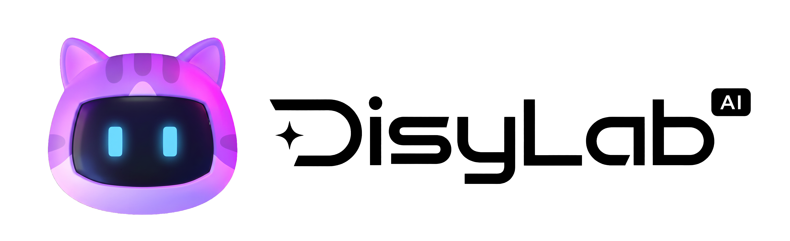

<p align="center">
  <picture>
    <source media="(prefers-color-scheme: dark)" srcset="docs/assets/logo-black.png" />
    <source media="(prefers-color-scheme: light)" srcset="docs/assets/logo-white.png" />
    
  </picture>
</p>

<h1 align="center">DisyLab Canvas</h1>

<p align="center">
  <a href="README.md">简体中文</a> · 繁體中文 · <a href="README.en.md">English</a>
</p>

<p align="center">
  <strong>讓角色、參考素材、提示詞與每一次嘗試，都留在同一張會持續生長的畫布上。</strong>
</p>

<p align="center">
  為設計師、電商視覺工作者與內容創作者打造的本機優先 AI 無限畫布。
</p>

<p align="center">
  <a href="https://disylab.pages.dev">線上體驗</a> ·
  <a href="https://tyaash.github.io/DisyLab-Canvas/">專案官網</a> ·
  <a href="#快速開始">快速開始</a> ·
  <a href="https://github.com/TyaAsh/DisyLab-Canvas/releases/download/v2.0.1/DisyLab_2.0.1_x64-setup.exe">下載 Windows 版</a> ·
  <a href="https://tyaash.github.io/DisyLab-Canvas/#roadmap">發展路線</a>
</p>

<p align="center">
  
  
  
  
</p>

> [!IMPORTANT]
> **DisyLab 是原始碼公開可見（source-available）的專有軟體，不是開源軟體。** 未經著作權人事先書面許可，不得商用、販售、出租、白標、再散布、再授權，或將本專案及其修改版本用於收費服務。詳見[中文授權聲明](LICENSE.zh-CN.md)與[英文授權條款](LICENSE)。

## 目前重點

- **Skill 系統**：在對話中逐題使用引導 Skill，從文字、圖片或影片節點直接套用相容的 Skill，並可匯入及管理自訂 Skill。
- **漫畫分鏡工作流**：從內容拆解、版式選擇、構圖確認到素材生成形成可持續編輯的節點流程。
- **檔案工具箱**：支援圖片、影片及 PDF 壓縮、PDF 合併，以及圖片與影片的選區去浮水印。
- **個人中心與專案管理**：統一專案首頁、搜尋、列表／宮格、批次選取與匯入匯出。
- **互動與穩定性修復**：修復遮罩穿透、彈窗層級、小地圖拖曳與 Skill 面板可讀性問題。
- **具畫布上下文的 Disy Agent**：依據任務來源專案、畫布、選取節點、參考素材與對話歷史，自動判斷規劃或執行。
- **跨畫布背景執行**：切換到其他專案或畫布時，Agent 與媒體任務仍會把結果寫回來源畫布。
- **Agent 專案工具**：使用專案記憶、任務中心與可依創作場景設定的團隊角色。
- **生成確認**：在確認卡調整可用模型、支援的規格及圖片生成數量。
- **畫布圖層**：可浮動或固定，支援群組、複製、重新命名和拖曳排序。
- **可恢復的影片媒體**：盡可能將結果歸檔到本機，並透過受控轉發恢復截幀、剪輯與裁剪能力。

## 核心能力

- 無限畫布、節點連線與多畫布專案管理。
- 文字、上傳、圖片、影片與 Agent 節點。
- 圖片生成、影片生成、剪輯、裁剪與截幀。
- 工作流範本、靈感庫、資產庫與生成歷史。
- 本機優先儲存與 `.disy` 專案匯入／匯出。
- 可在介面中自行設定需要的 API 連線。
- API Key 獨立保存，不寫入匯出的專案包。

## 快速開始

需要 Node.js 22.12 或更新版本。

```bash
npm ci
npm run dev
```

正式建置：

```bash
npm run typecheck
npm test
npm run build
```

## 目前範圍

DisyLab 2.0 提供網頁版與 Windows x64 桌面版。桌面版支援即夢官方 CLI 授權與獨立的 Muse 網頁登入工作階段。macOS 版稍後推出。專案儲存在本機，可用 `.disy` 專案包移轉。[2.0.1 發布頁](https://github.com/TyaAsh/DisyLab-Canvas/releases/tag/v2.0.1)提供安裝包及校驗檔案。

## 授權

Copyright © 2026 Ash / Tya. All rights reserved. 詳見 [LICENSE](LICENSE)、[LICENSE.zh-CN.md](LICENSE.zh-CN.md) 與 [COMMERCIAL-LICENSE.md](COMMERCIAL-LICENSE.md)。
