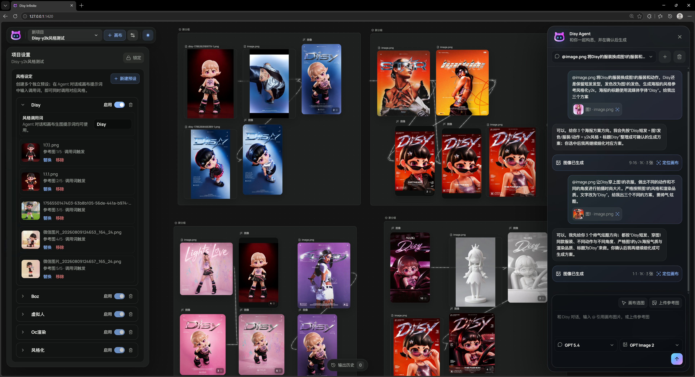
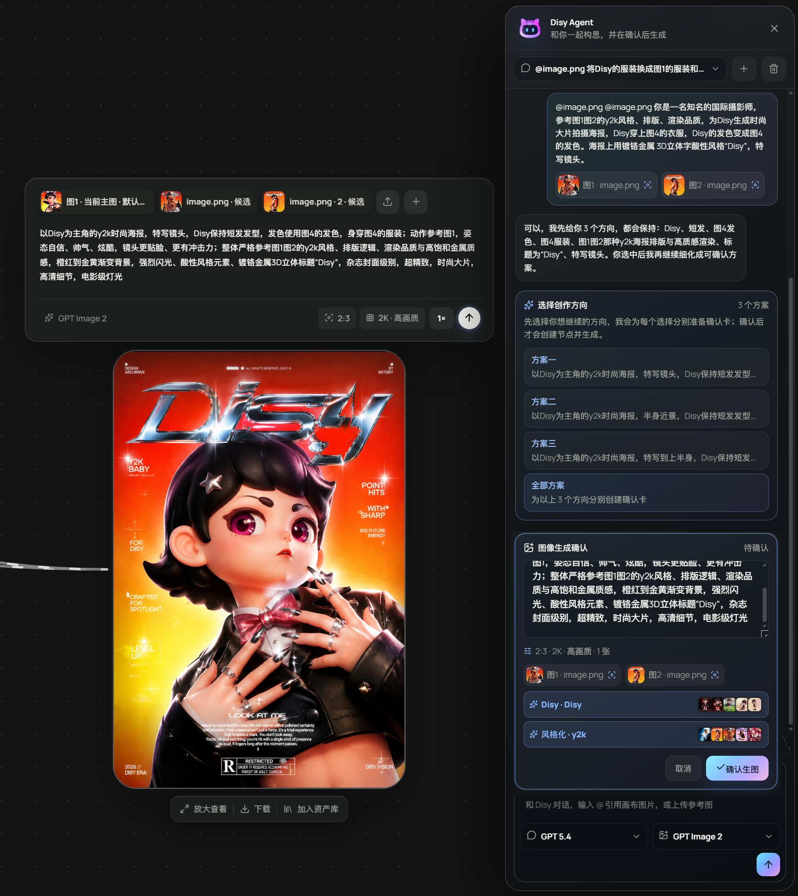
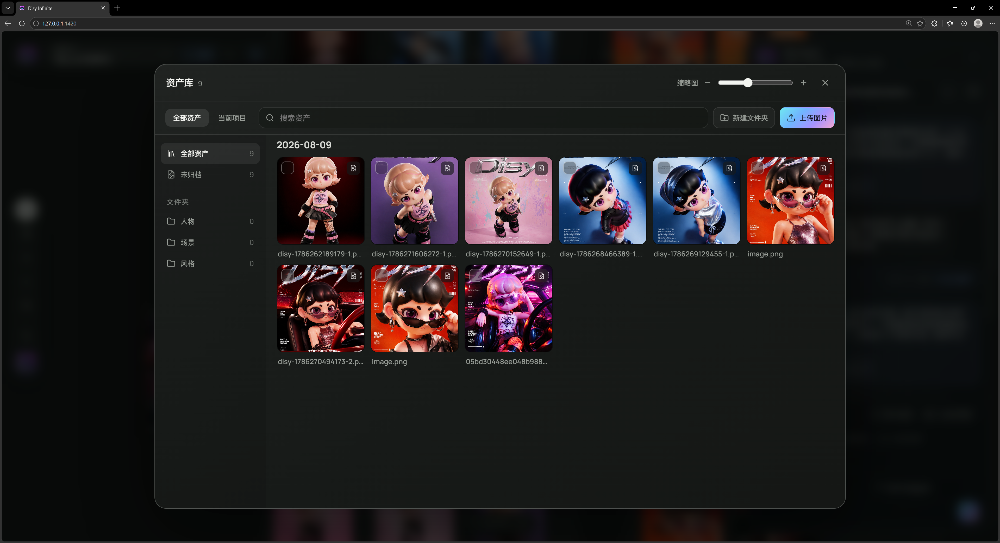

<p align="center">
  <picture>
    <source media="(prefers-color-scheme: dark)" srcset="docs/assets/logo-black.png" />
    <source media="(prefers-color-scheme: light)" srcset="docs/assets/logo-white.png" />
    
  </picture>
</p>

<h1 align="center">DisyLab Canvas</h1>

<p align="center"><strong>把靈感、參考素材、生成過程和可複用資產留在同一張會生長的畫布上。</strong></p>
<p align="center">面向設計師、電商視覺工作者與內容創作者的本地優先 AI 無限畫布。</p>

<p align="center">
  <a href="https://disylab.pages.dev/">線上體驗</a> ·
  <a href="https://tyaash.github.io/DisyLab-Canvas/">專案介紹</a> ·
  <a href="#本地執行">本地執行</a> ·
  <a href="#部署">部署</a> ·
  <a href="README.en.md">English</a> ·
  <a href="README.zh-TW.md">繁體中文</a>
</p>

<p align="center">
  
</p>

> [!IMPORTANT]
> DisyLab 是原始碼公開可見（source-available）的專有軟體，不是開源軟體。未經書面許可，不得商用、售賣、白標、再分發或將本專案及其修改版本用於收費服務。詳見[中文授權宣告](LICENSE.zh-CN.md)與[英文許可證](LICENSE)。

## 這是什麼？

DisyLab Canvas 是一張用來做設計和影片的 AI 無限畫布。你可以把想法、參考圖、影片、提示詞和生成結果放在一起，邊聊邊做，不用在多個工具之間來回搬素材。



## 第一次使用，跟著這四步走

1. 開啟[線上版](https://disylab.pages.dev/)，新建一個專案。
2. 在「設定 → API 設定」中填寫自己的廠商地址和 API Key，獲取模型後，勾選要用的文字、影像或影片模型。生成費用由你選擇的廠商收取。
3. 開啟 Disy Agent，說出想做什麼；有參考圖或影片就一起新增。沒有完整想法也可以先聊方向。
4. 檢視結果，不滿意可以繼續描述修改。完成後下載素材，或匯出 `.disy` 專案包，留作備份。

例如：“幫我做一張暖色咖啡海報，豎版 9:16，不要文字。”

**重要：**線上版的資料儲存在當前瀏覽器，不是雲端同步。清理瀏覽器資料或換裝置前，請先匯出專案。API Key 不會隨專案包匯出。

## 最近更新

- **三種介面語言**：在「設定 → 語言與顯示」中切換簡體中文、繁體中文或 English，立即生效，不需要重新整理頁面。
- **更自然的 Agent 對話**：智慧模式會根據需求清晰程度給建議或推進製作；協作模式先討論方案；直接生成模式減少不必要的確認。重要資訊缺失或需求有衝突時，仍會先說明。
- **圖片和影片自己選模型**：模型、比例、清晰度、時長等參數在輸入區就能調整，可選範圍跟隨當前模型。影片提供參考圖/影片、影片編輯、首尾幀三種工作方式，支援情況由模型決定。
- **影像規格補齊**：補入 Seedream 5.5 的 21:9、9:21 等比例；支援的模型會顯示透明背景、生成 GIF 開關。節點和 Agent 使用同一套能力配置，避免兩邊參數不一致。
- **訊息可複製、可編輯**：懸停到自己傳送的訊息即可操作。編輯在原訊息內進行，底部輸入框保留；對話訊息顯示時間。
- **結果更容易找**：多張圖片、多段影片可以開啟列表檢視和切換。輸出歷史展示成功、失敗和真實錯誤，便於排查餘額、許可權或下載問題。
- **參考素材更穩妥**：影片參考圖居中適配目標畫幅，避免硬拉伸；提示詞明確要求保留完整內容時採用保留內容的處理方式。生成模型本身仍可能改變細節。
- **介面更整齊**：專案、靈感庫、資產庫、生成歷史和設定統一彈窗尺寸與外觀，修復英文分類擠壓及重複“自適應”。
- 已移除專案記憶、舊團隊協作入口及 MUSE 接入，減少理解和配置負擔。
- **查看與找回本機資料**：儲存空間已併入統一設定視窗。資料庫內容可分類查看和管理；歷史媒體可在對應記錄下預覽、下載或還原至畫布，清理前會檢查引用並要求確認。


## Disy Agent：從沒想法到做出東西

你可以只說用途和想要的感覺，也可以直接給出模型、畫幅、數量及參考素材。Agent 會結合當前畫布繼續對話，必要時提供方向或可編輯確認卡；明確的製作要求可以直接推進。

確認卡保留了模型、提示詞與規格的調整入口。“先給方案，暫時不要生成”同樣有效。提示詞最佳化完成後可以撤回，恢復最佳化前的內容。



## 在畫布上整理素材與結果

- 使用多個專案和畫布整理不同任務，連線節點來說明素材關係。
- 圖片和影片支援上傳、生成、下載，以及從多個結果中挑選主要版本。
- 參考圖、參考影片可以拖動排序；影片縮圖幫助你辨認素材。
- 資產庫用來收納可重複使用的素材；生成歷史和輸出歷史用來查詢結果及任務記錄。
- 圖片支援區域性修改、擴圖、摳圖和宮格切分；影片支援截幀、裁剪及已有的編輯工具。
- 靈感庫提供參考案例；Skill 把常用的創作步驟整理成可複用流程，也能匯入自己的 Skill。
- 檔案工具箱提供圖片、影片、PDF 壓縮和 PDF 合併等本地工具。



## 本地執行

### Windows 雙擊啟動

先安裝 **Node.js 22.12 或以上版本**。第一次下載專案後，在專案資料夾開啟終端，執行一次：

```bash
npm ci
```

以後雙擊專案中的 **“启动 DisyLab.vbs”** 即可。啟動器會檢查本地服務，未執行就自動啟動，然後開啟瀏覽器；再次雙擊會複用已經執行的服務。

預設地址：`http://127.0.0.1:1420/`。瀏覽器關掉後本地服務仍可繼續執行；重啟電腦後，再雙擊啟動器即可。

遇到啟動問題時，檢視專案內 `.local/run/startup-error.txt` 或 `server.log`。這些本機日誌不會上傳到倉庫。

### 使用命令列

```bash
git clone https://github.com/TyaAsh/DisyLab-Canvas.git
cd DisyLab-Canvas
npm ci
npm run dev
```

這個倉庫當前釋出網頁版原始碼，不包含桌面安裝包工程。雙擊啟動器啟動的也是本地網頁版。

## 資料與隱私

- 專案、畫布、素材、歷史與對話預設儲存在當前裝置的瀏覽器儲存中。請定期匯出 `.disy` 專案包。
- API Key 只保留在當前瀏覽器標籤頁會話中，不寫入專案包或程式碼倉庫。
- 請求生成時，提示詞和所選參考素材會發送給你配置的模型廠商。
- HFSY 影片需要公網參考素材時，所選本地素材會臨時上傳到參考素材服務，供廠商讀取，通常四小時後過期。
- 不要在截圖、Issue 或公開聊天裡貼 API Key。若已洩露，請到廠商控制台撤銷並更換。

## 部署與檢查

線上應用：[disylab.pages.dev](https://disylab.pages.dev/)；[專案介紹頁](https://tyaash.github.io/DisyLab-Canvas/)與線上應用分開發布。

```bash
npm test
npm run build
npx wrangler pages deploy dist --project-name disylab --branch main
```

第一次部署需要登入自己的 Cloudflare 賬號。使用其他專案名時，把命令裡的 `disylab` 換成你的 Pages 專案名。

## 反饋與聯絡

反饋問題時，請說明操作步驟、想得到的結果、實際結果，以及瀏覽器和模型名稱；附圖會更容易定位。請勿附帶 API Key。

- [提交問題](https://github.com/TyaAsh/DisyLab-Canvas/issues)
- [專案路線圖](https://tyaash.github.io/DisyLab-Canvas/#roadmap)
- 小紅書：Disy宇宙電波
- 郵箱：ashhaveaniceday@gmail.com

## 授權

Copyright © 2026 DisyLab. All rights reserved.

DisyLab 是原始碼公開可見的專有軟體，公開可見或可 fork 不代表獲得商用、分發或衍生作品授權。

- [中文授權宣告](LICENSE.zh-CN.md)
- [English License](LICENSE)
- [權利標記與第三方邊界](NOTICE.md)
- [商業授權諮詢](COMMERCIAL-LICENSE.md)
